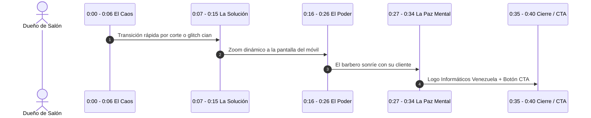

# 🎬 Contexto y Guion Maestro para Google Flow: Video Publicitario de Style SaaS
### **Campaña de Lanzamiento — Gestión Inteligente para Barberías y Salones**
**Marca:** Informáticos Venezuela  
**Producto:** Style SaaS  
**Formato de Video:** 9:16 (Vertical Reels / TikTok / WhatsApp Status) y adaptable a 16:9 (YouTube / Web)  
**Duración Sugerida:** 30 a 40 segundos  
**Estilo Visual:** Cinematográfico publicitario, Cyber Navy Deep, dinámico, elegante y tecnológico.

---

## 🎯 1. Meta-Contexto e Instrucción Inicial para Google Flow

Copia y pega este bloque en Google Flow para inicializar el asistente o proyecto:

```text
Actúa como un Director Creativo y Productor Audiovisual de nivel internacional especializado en anuncios de tecnología y software publicitario para negocios de belleza y barbería. 

Estamos creando un video comercial cinematográfico de alto impacto para "Style SaaS", una plataforma web desarrollada por "Informáticos Venezuela" para barberías, salones de belleza y spas. 

El objetivo del video es generar urgencia y deseo en dueños de barberías y estilistas: pasar del desorden del cuaderno de papel y las cuentas manuales a una gestión 100% digital en su teléfono, con cálculo legal automático a tasa oficial BCV, agenda de citas y recibos digitales por WhatsApp.

El tono debe ser premium, moderno, rápido y altamente convincente.
Paleta de colores estricta: Cyber Navy (#050914, #0A1226), Azul Neón/Cian (#00E5FF), Acentos Verde Esmeralda (#10B981) para dinero/facturación, y Blanco puro.
```

---

## 🎨 2. Dirección de Arte y Estilo Visual

- **Iluminación:** Contraste cinematográfico claroscuro (*Moody lighting*), luces de acento en cian neón y azul cobalto que bañan suavemente herramientas de barbería de alta gama (máquinas de corte doradas/negras, tijeras japonesas mate, navajas).
- **Cámara:** Movimientos suaves tipo *gimbal*, planos macro detalle (*macro close-up*), transiciones fluidas de velocidad (*speed ramps*), desenfoque de fondo elegante (*bokeh*).
- **Dispositivos en escena:** Smartphone moderno sin bordes mostrando la interfaz real de **Style SaaS** con tarjetas oscuras, tipografía Plus Jakarta Sans y gráficos nítidos.

---

## ⏱️ 3. Storyboard Detallado Escena por Escena



---

### **Escena 1: El Dolor y la Frustración (0:00 - 0:06)**
- **Visual:** Primer plano de un cuaderno sucio con tachaduras, hojas dobladas, una calculadora gastada al lado de unas tijeras. Un barbero agobiado revisa mensajes cruzados en WhatsApp mientras atiende a un cliente. Ambiente tenso y desorganizado.
- **Movimiento de cámara:** Cámara en mano lenta, iluminación tenue y pesada.
- **Voz en Off:** 
  > *"¿Sigues anotando tus citas y comisiones en un cuaderno? ¿Perdiendo dinero cada vez que la tasa cambia?"*

---

### **Escena 2: La Transformación Digital (0:07 - 0:14)**
- **Visual:** Un destello de luz cian neón barre la pantalla. El cuaderno se cierra con firmeza y entra en plano un smartphone de gama alta flotando sobre una superficie oscura y pulida. La pantalla se enciende mostrando el logo circular de Informáticos Venezuela y el panel de **Style SaaS**.
- **Movimiento de cámara:** Movimiento orbital 360° fluido con *speed ramp*.
- **Voz en Off:** 
  > *"Despídete del desorden. Llega Style SaaS: el control total de tu salón o barbería, directamente en tu teléfono."*

---

### **Escena 3: Las Tres Funciones Clave en Acción (0:15 - 0:26)**
- **Visual (Tríptico dinámico / Plano detalle):**
  1. *Sub-toma A:* La pantalla muestra la **Tasa Oficial BCV** actualizándose en vivo con una insignia verde esmeralda: `Bs. 49,85 / 1.00 USD`.
  2. *Sub-toma B:* El barbero toca la pantalla y agenda una cita en 2 segundos; el calendario se organiza con tarjetas nítidas.
  3. *Sub-toma C:* Presiona el botón verde `Recibo` y un comprobante digital impecable se envía al WhatsApp de la clienta al instante.
- **Efectos de sonido:** Clics táctiles futuristas, suave sonido de confirmación bancaria y notificación de mensaje recibido.
- **Voz en Off:** 
  > *"Cobros exactos en Dólares y Bolívares con tasa oficial BCV al segundo. Agenda inteligente sin cruces de turnos y recibos digitales listos para enviar a WhatsApp con un solo toque."*

---

### **Escena 4: El Éxito y la Experiencia Premium (0:27 - 0:34)**
- **Visual:** El barbero retira la capa a su cliente; el cliente se mira al espejo sonriendo, apreciando un degradado perfecto. El barbero revisa en su teléfono el total de ingresos del día con una gráfica en ascenso. El ambiente es sofisticado, limpio y profesional.
- **Movimiento de cámara:** Plano medio cenital con luz cálida frontal y contraluz cian.
- **Voz en Off:** 
  > *"Más tiempo para tus clientes, cero errores al cerrar caja y el respeto que merece tu negocio."*

---

### **Escena 5: Llamado a la Acción / CTA Final (0:35 - 0:40)**
- **Visual:** Pantalla final cinematográfica en fondo Cyber Navy profundo. En el centro aparece el logo circular emblemático de **Informáticos Venezuela** con halo de luz pulsante.
- **Texto en pantalla (Tipografía audaz):**
  - **STYLE SAAS**
  - **¡SOLICITA TU MES DE PRUEBA GRATIS!**
  - Web: `style.informaticosvenezuela.com`
  - WhatsApp: `+58 424-2964339`
- **Voz en Off:** 
  > *"Moderniza tu negocio hoy mismo. Solicita tu mes de prueba gratis con Informáticos Venezuela."*

---

## 🤖 4. Prompts Técnicos de Generación de Video (Optimizados para Google Flow / Veo / AI Video)

Si Google Flow te pide prompts escena por escena en formato técnico de video:

### Prompt Escena 1 (El Caos):
```text
Cinematic close-up shot of a messy barbershop wooden counter. A worn-out paper notebook full of scratched handwritten notes, ink stains, and an old calculator next to barber scissors and clipper blades. A busy barber looking stressed while checking a smartphone. Moody low-key lighting, shallow depth of field, 35mm lens, photorealistic 8k, cinematic color grade with cool shadows.
```

### Prompt Escena 2 (La Revelación Tecnológica):
```text
Sleek cinematic transition. The messy counter dissolves into a futuristic dark glossy table. An elegant black bezel-less smartphone rotates in slow motion, floating in mid-air. The smartphone screen lights up brightly, displaying a dark Cyber Navy mobile app interface with glowing electric cyan accents and a glowing circular logo. Neon cyan and deep blue volumetric rim lighting, smooth camera orbit, 60fps, 4k commercial look.
```

### Prompt Escena 3 (La Interfaz y Funciones):
```text
Extreme macro detail shot of clean fingers smoothly interacting with a premium smartphone screen. The app interface displays bimonetaria currency conversions with green emerald badges showing "Bs. 49,85 / 1.00 USD" and a clean appointment calendar. A button tap generates a digital invoice that sends directly to WhatsApp. Sleek UI animation, crisp typography, electric cyan backlight reflections, ultra-high resolution.
```

### Prompt Escena 4 (Satisfacción y Profesionalismo):
```text
Medium cinematic shot inside a luxury modern barbershop with dark navy walls and neon ambient lighting. A stylish male client smiles looking at his fresh haircut in the mirror. In the background, the confident barber smiles looking at his phone summary screen. High-end atmosphere, cinematic bokeh, anamorphic lens flare, warm interior highlights with cool navy contrast.
```

### Prompt Escena 5 (Outro & Logo Reveal):
```text
Clean minimalist motion graphics outro. Deep cyber navy background (#050914) with subtle floating barber vector particles. A luminous circular emblem logo centers and pulses with a soft cyan glow. Bold modern 3D text emerges: "STYLE SAAS — Moderniza tu Salón". Neon cyan glowing button at bottom: "Mes de Prueba Gratis". Sleek corporate tech finish, 4k render.
```

---

## 🎧 5. Especificaciones de Audio y Música Sugerida

- **Pista de Fondo:** *Modern Tech Trap / Lo-Fi Electronic Beat* con bajo profundo 808, sintetizadores suaves y ritmo ágil que transmita vanguardia, confianza y energía sin ser ruidoso.
- **Voz en Off:** Masculina o femenina joven-adulta (25-35 años), segura, enérgica, con acento venezolano neutro profesional.
