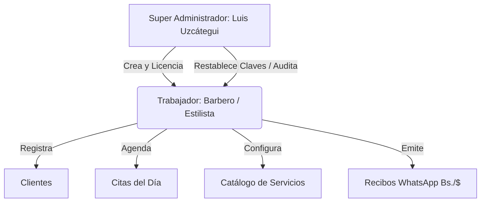

# 📖 Manual de Usuario Oficial — Style SaaS
### **Plataforma de Gestión Integral para Barberías, Salones de Belleza y Spas**
**Desarrollado por:** Informáticos Venezuela  
**Edición:** Producción v2.5 (Cyber Navy Edition)  
**Dominio Oficial:** [style.informaticosvenezuela.com](https://style.informaticosvenezuela.com/)

---

## 📑 Tabla de Contenidos
1. [Visión General del Sistema](#1-visión-general-del-sistema)
2. [Arquitectura de Roles y Accesos](#2-arquitectura-de-roles-y-accesos)
3. [Portal de Autenticación y Seguridad](#3-portal-de-autenticación-y-seguridad)
   - [3.1 Inicio de Sesión](#31-inicio-de-sesión)
   - [3.2 Requisitos de Contraseña y Semáforo de Fortaleza](#32-requisitos-de-contraseña-y-semáforo-de-fortaleza)
   - [3.3 Restablecimiento de Contraseña (Auto-servicio)](#33-restablecimiento-de-contraseña-auto-servicio)
   - [3.4 Restablecimiento Asistido por Super Administrador](#34-restablecimiento-asistido-por-super-administrador)
4. [Módulo del Trabajador / Estilista / Barbero](#4-módulo-del-trabajador--estilista--barbero)
   - [4.1 Agenda y Calendario Interactivo](#41-agenda-y-calendario-interactivo)
   - [4.2 Registro y Gestión de Citas](#42-registro-y-gestión-de-citas)
   - [4.3 Directorio de Clientes (Registro Express)](#43-directorio-de-clientes-registro-express)
   - [4.4 Catálogo de Servicios y Precios Bimonetarios](#44-catálogo-de-servicios-y-precios-bimonetarios)
   - [4.5 Recibo Digital de WhatsApp y Comprobantes](#45-recibo-digital-de-whatsapp-y-comprobantes)
   - [4.6 Widget y Conversión de Tasa Oficial BCV](#46-widget-y-conversión-de-tasa-oficial-bcv)
5. [Módulo del Super Administrador (Panel Maestro)](#5-módulo-del-super-administrador-panel-maestro)
   - [5.1 Registro y Gestión de Trabajadores](#51-registro-y-gestión-de-trabajadores)
   - [5.2 Asignación y Control de Licencias / Vigencia](#52-asignación-y-control-de-licencias--vigencia)
   - [5.3 Gestión de Credenciales y Seguridad de Cuentas](#53-gestión-de-credenciales-y-seguridad-de-cuentas)
   - [5.4 Auditoría de Seguridad Inmutable (Audit Logs)](#54-auditoría-de-seguridad-inmutable-audit-logs)
   - [5.5 Métricas Globales del Negocio](#55-métricas-globales-del-negocio)
6. [Preguntas Frecuentes (FAQ) y Buenas Prácticas](#6-preguntas-frecuentes-faq-y-buenas-prácticas)
7. [Canales de Soporte y Contacto](#7-canales-de-soporte-y-contacto)

---

## 1. Visión General del Sistema

**Style SaaS** es una solución web progresiva diseñada para eliminar de raíz el uso de cuadernos y cálculos manuales en salones de belleza, barberías, spas y nail bars. El sistema opera bajo un esquema bimonetario nativo que sincroniza en tiempo real la tasa del Banco Central de Venezuela (BCV), permitiendo tarifar en dólares estadounidenses ($) y cobrar con exactitud legal en bolívares (Bs.).

### Beneficios Clave
- **Cero errores en cobros:** Conversión automática a tasa oficial BCV al instante.
- **Control de clientes:** Historial de visitas y contacto telefónico directo a WhatsApp.
- **Recibos automáticos:** Envío de comprobantes de servicio a clientes sin impresoras térmicas costosas.
- **Seguridad multi-inquilino (Multi-tenant):** Cada barbero o salón cuenta con aislamiento estricto de su información.

---

## 2. Arquitectura de Roles y Accesos

El sistema cuenta con dos niveles jerárquicos de operación:

1. **Super Administrador (`SUPER_ADMIN`):**
   - Acceso total a la infraestructura.
   - Emisión, renovación o revocación de licencias de uso.
   - Creación de cuentas para estilistas y barberos.
   - Reasignación de contraseñas olvidadas.
   - Inspección de registros de auditoría y métricas globales.

2. **Trabajador / Barbero / Estilista (`WORKER`):**
   - Acceso enfocado en su operación diaria.
   - Gestión de su agenda de citas (pendientes, en proceso, completadas).
   - Registro express de clientes con enlace directo a WhatsApp.
   - Gestión de su propio portafolio de servicios y tarifas.
   - Emisión de facturas y recibos digitales para WhatsApp.

---

## 3. Portal de Autenticación y Seguridad

### 3.1 Inicio de Sesión
1. Abra su navegador e ingrese a [style.informaticosvenezuela.com](https://style.informaticosvenezuela.com/).
2. En el campo **"Cédula o Correo"**, ingrese su documento de identidad (ej. `V-12345678`) o su correo electrónico registrado.
3. En el campo **"Contraseña"**, ingrese su clave secreta. Puede hacer clic en el ícono del **ojo** para verificar lo que escribió.
4. Presione el botón **"Entrar al Sistema"**.

> [!NOTE]
> El sistema cuenta con protección anti-fuerza bruta mediante *rate limiting*. Si se ingresa una contraseña incorrecta repetidas veces, la IP será bloqueada temporalmente por 15 minutos para salvaguardar la cuenta.

---

### 3.2 Requisitos de Contraseña y Semáforo de Fortaleza
Toda contraseña creada o actualizada en Style SaaS debe cumplir con la política de seguridad bancaria:

- **Longitud mínima:** 8 caracteres.
- **Mayúsculas:** Al menos una letra mayúscula (`A-Z`).
- **Minúsculas:** Al menos una letra minúscula (`a-z`).
- **Números:** Al menos un dígito numérico (`0-9`).

Al escribir una nueva contraseña, el sistema muestra en tiempo real un **Semáforo Interactivo**:
- 🔴 **Rojo (Débil):** Menos de 2 requisitos cumplidos.
- 🟡 **Amarillo (Media):** 3 requisitos cumplidos.
- 🟢 **Verde (Segura):** Todos los requisitos aprobados.

---

### 3.3 Restablecimiento de Contraseña (Auto-servicio)
Si olvidó su contraseña y tiene acceso a su correo electrónico:

1. En la pantalla de login, haga clic en:  
   `¿Olvidaste tu contraseña? Restablécela aquí`.
2. Ingrese su **Cédula de Identidad** registrada y su **Correo Electrónico**.
3. Ingrese su **Nueva Contraseña** y confírmela respetando los requisitos del semáforo.
4. Presione **"Restablecer mi Contraseña"**.
5. El sistema validará su identidad, registrará el cambio en la bitácora de auditoría y le permitirá entrar de inmediato.

---

### 3.4 Restablecimiento Asistido por Super Administrador
Si el trabajador no recuerda su correo o fue bloqueado, el Super Administrador puede reasignarle una clave en segundos:

1. El Super Administrador ingresa a su panel y va a la pestaña **"Trabajadores"**.
2. En la fila del barbero, hace clic en el botón azul **"🔑 Clave"**.
3. Escribe la nueva contraseña temporal (ej. `Style2026*`).
4. Presiona **"Asignar Nueva Clave"**.
5. El trabajador ya puede ingresar inmediatamente con esa clave.

---

## 4. Módulo del Trabajador / Estilista / Barbero

Al iniciar sesión, el trabajador visualiza su panel operativo dividido en tres áreas accesibles desde la barra superior:
- 📅 **Agenda / Citas**
- 👥 **Mis Clientes**
- ✂️ **Servicios**

### 4.1 Agenda y Calendario Interactivo
- Permite ver las citas programadas para el día actual o explorar fechas anteriores y futuras.
- Cada tarjeta de cita muestra:
  - Nombre del cliente y teléfono con botón de acceso a WhatsApp.
  - Nombre del servicio solicitado.
  - Hora pactada.
  - Monto en USD ($) y el monto equivalente exacto en Bolívares (Bs.).
  - Estado actual de la cita (**Pendiente**, **En Proceso** o **Completada**).

---

### 4.2 Registro y Gestión de Citas
Para agendar a un cliente:

1. En la pestaña **"Agenda"**, haga clic en el botón verde **"+ Nueva Cita"**.
2. Seleccione la **Clienta / Cliente** de la lista desplegable (o regístrelo previamente).
3. Seleccione el **Servicio** que se realizará (el precio en USD y Bs. se autocompleta).
4. Indique la **Fecha y Hora** de la cita.
5. Presione **"Confirmar y Agendar"**.

#### Cambio de Estado:
- Al terminar el corte o servicio, presione el botón **"Completar"** en la tarjeta de la cita. El estado cambiará a verde y se habilitará la emisión del recibo digital.

---

### 4.3 Directorio de Clientes (Registro Express)
Style SaaS optimiza el tiempo de atención requiriendo solo 3 datos esenciales:

1. Vaya a la pestaña **"Mis Clientes"**.
2. Haga clic en **"+ Nueva Cliente"**.
3. Complete los campos:
   - **Nombre Completo:** (Ej. *María Fernández*)
   - **Teléfono:** (Ej. *0414-1234567* o *0424-9876543*)
   - **Dirección Corta / Sector:** (Ej. *El Paraíso*, *Cagigal*, etc.)
4. Presione **"Guardar Cliente"**.

> [!TIP]
> En la lista de clientes, al hacer clic en el ícono de **WhatsApp**, se abrirá directamente el chat con ese cliente en su teléfono o computadora para confirmaciones de citas.

---

### 4.4 Catálogo de Servicios y Precios Bimonetarios
Configure los tratamientos y cortes que ofrece su salón:

1. Vaya a la pestaña **"Servicios"**.
2. Haga clic en **"+ Nuevo Servicio"**.
3. Ingrese el **Nombre del Servicio** (ej. *Corte Degradado + Barba*, *Balayage*, *Secado y Planchado*).
4. Ingrese el **Precio Base en USD ($)** (ej. `$15.00`).
5. El sistema calculará automáticamente la tarifa equivalente en Bolívares según la tasa BCV del momento.
6. Presione **"Registrar Servicio"**.

---

### 4.5 Recibo Digital de WhatsApp y Comprobantes
Elimine el gasto en papel térmico e impresoras:

1. En la cita completada, haga clic en el botón **"🧾 Recibo"**.
2. Se desplegará una ventana con el comprobante pre-formateado que incluye:
   - Encabezado oficial del salón y fecha del servicio.
   - Nombre de la clienta.
   - Detalle del servicio y monto en USD ($).
   - Tasa oficial BCV aplicada y total exacto a cancelar en Bolívares (Bs.).
3. Opciones de entrega:
   - **"Enviar por WhatsApp"**: Abre WhatsApp automáticamente con el mensaje listo para enviar.
   - **"Copiar Texto"**: Copia el recibo al portapapeles para pegarlo en cualquier chat.

---

### 4.6 Widget y Conversión de Tasa Oficial BCV
En la esquina superior del panel se ubica el **Widget de Tasa BCV**:
- Muestra la tasa cambiaria oficial vigente.
- Cualquier actualización en el valor de la divisa se refleja inmediatamente en todos los servicios y citas activas sin necesidad de recalcular manualmente.

---

## 5. Módulo del Super Administrador (Panel Maestro)

Diseñado para **Luis Uzcátegui** y la gerencia de **Informáticos Venezuela**.

### 5.1 Registro y Gestión de Trabajadores
1. Inicie sesión con credenciales de Super Administrador.
2. En la pestaña **"Trabajadores"**, haga clic en **"+ Nuevo Trabajador"**.
3. Ingrese los datos del estilista:
   - Nombres y Apellidos.
   - Cédula de Identidad (clave única para acceso).
   - Correo Electrónico oficial.
   - Teléfono celular.
   - Dirección corta o sucursal.
   - Contraseña inicial asignada.
   - **Meses de Licencia Inicial** (ej. 1 mes, 3 meses, 6 meses, 12 meses).
4. Presione **"Crear Cuenta de Trabajador"**.

---

### 5.2 Asignación y Control de Licencias / Vigencia
Cada cuenta de trabajador posee una fecha de vencimiento (`licenseExpiresAt`):
- **Estado Activo (Verde):** La cuenta tiene licencia vigente.
- **Estado Por Vencer (Amarillo):** Faltan menos de 7 días para el vencimiento.
- **Estado Vencido / Bloqueado (Rojo):** La licencia expiró; el trabajador no podrá acceder a su agenda hasta que sea renovada.

#### Para Renovar una Licencia:
- En la fila del trabajador, presione **"+ Renovar Licencia"** y seleccione los meses adicionales pagados.
- Para suspensión temporal por mora o mantenimiento, presione **"Suspender (Ban)"**.

---

### 5.3 Gestión de Credenciales y Seguridad de Cuentas
- Botón **"🔑 Clave"**: Permite cambiar inmediatamente la contraseña de cualquier usuario sin necesidad de confirmación por correo.
- Registro estricto de auditoría: Cada cambio de clave genera una traza con la IP del administrador y la fecha exacta.

---

### 5.4 Auditoría de Seguridad Inmutable (Audit Logs)
En la pestaña **"Auditoría"**, el Super Admin puede auditar cada evento relevante del sistema:
- `AUTH_LOGIN_SUCCESS`: Inicios de sesión con IP y agente de usuario.
- `AUTH_PASSWORD_RESET`: Solicitudes y cambios de contraseña.
- `ADMIN_PASSWORD_OVERRIDE`: Restablecimientos manuales ejecutados por el administrador.
- `LICENSE_RENEWAL`: Extensiones de suscripción aplicadas.
- `LICENSE_SUSPENSION`: Bloqueos de cuenta.

---

### 5.5 Métricas Globales del Negocio
En la pestaña **"Resumen General"**:
- Total de salones y barberos suscritos.
- Citas totales agendadas en la plataforma.
- Tasa de retención de suscripciones mensuales.

---

## 6. Preguntas Frecuentes (FAQ) y Buenas Prácticas

### ¿Qué sucede si la tasa del BCV cambia a mitad del día?
Style SaaS sincroniza la tasa oficial. Las citas creadas antes del cambio conservan el monto acordado, mientras que los nuevos cobros se calculan con la tasa vigente sin que usted deba modificar precio por precio.

### ¿Puedo utilizar el sistema desde mi teléfono celular?
**Sí.** Style SaaS es 100% responsivo (diseñado primero para teléfonos móviles). Funciona en Google Chrome, Safari y cualquier navegador móvil sin necesidad de descargar una app pesada de la Play Store.

### ¿Qué debo hacer si un cliente no tiene número de WhatsApp?
Puede registrar un número fijo o genérico temporal. El sistema generará el recibo igualmente y usted podrá leerle el total o enviarlo por SMS/correo.

### ¿Los barberos pueden ver los clientes o ingresos de otros barberos?
**No.** El sistema aplica aislamiento estricto por inquilino (*Multi-tenant Data Isolation*). Cada trabajador solo tiene visibilidad sobre su propia agenda, sus clientes y sus finanzas.

---

## 7. Canales de Soporte y Contacto

Para soporte técnico, alta de nuevos locales, renovación de licencias o sugerencias de desarrollo:

- 🌐 **Portal Web:** [style.informaticosvenezuela.com](https://style.informaticosvenezuela.com/)
- 📲 **WhatsApp de Soporte Directo:** [+58 424-2964339](https://wa.me/584242964339)
- 🏢 **Desarrollo y Respaldo:** Informáticos Venezuela
- 👤 **Super Administrador Maestro:** Luis Uzcátegui
