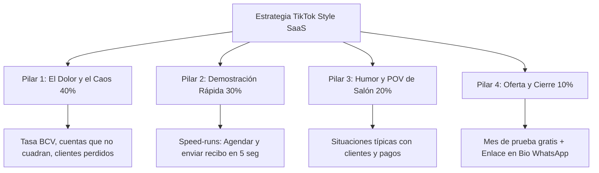
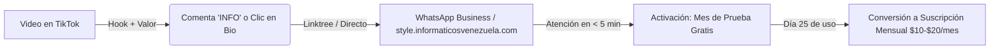

# 📱 Estrategia de Marketing en TikTok para Style SaaS
### **Plan Maestro de Adquisición Orgánica y Conversión para Barberías y Salones en Venezuela**
**Marca:** Informáticos Venezuela  
**Producto:** Style SaaS ([style.informaticosvenezuela.com](https://style.informaticosvenezuela.com/))  
**Objetivo:** Captar dueños de salones, barberos y estilistas para activar su **Mes de Prueba Gratis** y convertirlos en suscriptores recurrentes.

---

## 🧠 1. Psicología del Nicho en TikTok (Venezuela)

En TikTok no se vende software corporativo; **se vende alivio al estrés diario y estatus profesional**.

### ¿Quién es tu cliente en TikTok?
1. **El Barbero / Estilista Joven (18 - 30 años):**
   - Pasa 2 a 4 horas al día en TikTok viendo tendencias de cortes, degradados y humor de barbería.
   - Quiere verse profesional ante sus clientes, tener su portafolio en orden y que no le roben con las comisiones ni las cuentas de los insumos.
2. **El Dueño de Salón / Barbershop (28 - 50 años):**
   - Sufre al final del día con el cuaderno: tachones, cuentas que no cuadran, dinero en efectivo en dólares mezclado con pago móvil y la tasa del BCV que cambió a mitad de tarde.
   - Tiene miedo de que el software sea difícil de usar o requiera una computadora cara que no tiene en el local.

### La Regla de Oro de TikTok:
> **"No vendas las características del SaaS, vende la pesadilla del cuaderno y la tranquilidad de tener el negocio en el teléfono."**

---

## 🏛️ 2. Los 4 Pilares de Contenido (Matriz Semanal)

Para que el algoritmo de TikTok empuje tus videos a dueños de negocios locales en Venezuela, distribuiremos el contenido en 4 pilares:

---

### **Pilar 1: El Dolor y el Caos (40% del contenido — Alcance)**
- **Objetivo:** Tocar la herida del cuaderno y la pérdida de dinero.
- **Temas:**
  - *"Lo que pierdes al mes por no cobrar con la tasa oficial BCV exacta."*
  - *"El cuaderno de citas: por qué tus clientes se van con la competencia."*
  - *"Cerrar caja a las 9:00 PM con calculadora vs. cerrar en 10 segundos en tu celular."*

### **Pilar 2: Demostración Rápida / "Tech Flex" (30% del contenido — Deseo)**
- **Objetivo:** Mostrar que la app es ultrarrápida, hermosa y fácil.
- **Temas:**
  - *Speed-run:* Agendando una cita y enviando el recibo formal de WhatsApp al cliente en 5 segundos.
  - La pantalla mostrando la conversión automática de `$15.00` a Bolívares con la tasa BCV al segundo.
  - Instalación tipo PWA: Cómo queda el icono de Style SaaS en la pantalla del celular como una app nativa.

### **Pilar 3: Humor, POV y Situaciones del Salón (20% del contenido — Viralidad)**
- **Objetivo:** Humanizar la marca y lograr que los barberos compartan el video en sus grupos de WhatsApp.
- **Temas:**
  - *POV:* *"Cuando el cliente te dice 'te pasé el pago móvil a tasa de ayer'..."*
  - *POV:* *"El barbero intentando entender los números del cuaderno que mojaron con fijador."*
  - El dueño del salón relajado tomando café mientras el teléfono calcula las comisiones solo.

### **Pilar 4: Conversión Directa y Prueba Social (10% del contenido — Ventas)**
- **Objetivo:** Mandar tráfico masivo al WhatsApp y a la web.
- **Temas:**
  - Explicación de la oferta: *"Te damos 1 mes completo gratis para tu barbería. Si no te ahorra 2 horas al día, no pagas nada."*
  - Presentador oficial invitando a probar Style SaaS con el enlace en la biografía.

---

## ⚡ 3. Anatomía del Hook de 3 Segundos (Ganchos Comprobados)

En TikTok tienes menos de 2 segundos antes de que el usuario haga *scroll*. Tus primeros 3 segundos deben frenar el pulgar:

| Tipo de Gancho | Frase Inicial (Texto en pantalla + Audio) | Visual de Impacto |
| :--- | :--- | :--- |
| **Pérdida de Dinero** | *"Si tienes una barbería en Venezuela, estás perdiendo plata todos los días aquí..."* | Plano detalle de un cuaderno tachado y una calculadora vieja. |
| **Pregunta Provocadora** | *"¿Todavía cierras caja a mano a las 9 de la noche?"* | El barbero cansado con la cabeza sobre el mostrador. |
| **Comparativa Rápida** | *"Barbero tradicional vs. Barbero con Style SaaS en su teléfono."* | Pantalla dividida: caos de papel vs. celular Cyber Navy fluido. |
| **Truco / Hack** | *"El truco para enviar recibos con tasa BCV a WhatsApp sin imprimir papel."* | Mano tocando el botón verde de recibo en el teléfono. |

---

## 🎬 4. Tres Guiones Listos para Grabar (Scripts)

### 📜 Guion 1: "La Pesadilla del Cuaderno" (Educativo / Dolor)
- **Duración:** 25 segundos
- **Sonido de fondo:** Audio en tendencia suave o beat urbano tranquilo.
- **Tomas:**
  - **0:00 - 0:03 (Hook):** [Enfocar cuaderno rayado con tinta corrida]  
    *Voz:* "Dime que tienes una barbería en Venezuela sin decirme que sufres todas las noches con esto."
  - **0:03 - 0:10:** [Corte al barbero sumando con la calculadora mientras le vibra el teléfono]  
    *Voz:* "Tasa del dólar que cambió a las 2:00 PM, comisiones mal calculadas y clientes peleando por turnos cruzados."
  - **0:10 - 0:18:** [Transición limpia: entra el celular con Style SaaS]  
    *Voz:* "Por eso creamos Style SaaS. Toda tu barbería en tu celular. Cálculo oficial BCV automático, agenda de citas y control de comisiones al segundo."
  - **0:18 - 0:25 (CTA):** [Aparece el flyer con el presentador]  
    *Voz:* "Pruébalo gratis durante todo un mes. Toca el enlace de nuestro perfil y actívalo hoy."

---

### 📜 Guion 2: "El Recibo de WhatsApp en 5 Segundos" (Demostración de Producto)
- **Duración:** 18 segundos
- **Formato:** Grabación de pantalla del celular o mano sosteniendo el teléfono en el salón.
- **Tomas:**
  - **0:00 - 0:02 (Hook):** [Texto grande arriba: *¿Aún compras rollos de papel térmico para dar recibos?*]  
    *Voz:* "Mira cómo se entrega un recibo profesional hoy en día en Venezuela."
  - **0:02 - 0:09:** [Grabación de pantalla de Style SaaS: clic en 'Completar Cita' $\rightarrow$ clic en '🧾 Recibo']  
    *Voz:* "El cliente termina su corte, tocas un botón y el sistema calcula los Bolívares exactos a tasa BCV."
  - **0:09 - 0:14:** [Se abre WhatsApp con el mensaje formateado listo]  
    *Voz:* "Un toque y le llega a su WhatsApp con el logo de tu local. Cero impresoras, cero gastos."
  - **0:14 - 0:18 (CTA):** [Texto: *Prueba 1 mes gratis en el link del perfil*]  
    *Voz:* "Comenta 'STYLE' o entra al link de la bio para probarlo gratis."

---

### 📜 Guion 3: "Uso del Video del Presentador de Google Flow" (Anuncio / Spark Ad)
- **Duración:** 10 segundos
- **Estrategia:** Este video es perfecto para usarlo como **TikTok Ad (In-Feed Ad)** o como video anclado (*Pinned Video*) en el perfil.
- **Optimización en TikTok:**
  - **Texto superpuesto en el video (Stickers nativos de TikTok):**
    - [Segundo 0-3]: *"Atención Barberías y Salones en Venezuela 🇻🇪"*
    - [Segundo 3-7]: *"Controla citas, comisiones y tasa BCV en tu celular 📲"*
    - [Segundo 7-10]: *"1 Mes de Prueba Gratis 👇 Link en Bio"*
  - **Copy de la publicación (Descripción):**
    > *Dile adiós al cuaderno de papel y a los dolores de cabeza al cerrar el día. 💈 Con Style SaaS controlas tus citas, cobras exacto a tasa BCV y calculas comisiones sin errores. 🚀 Solicita tu mes de prueba 100% gratis en el link de nuestro perfil o al WhatsApp +58 424-2964339. #barberiasvenezuela #barberosvenezolanos #salonesdebellezavenezuela #caracas #venezuela #stylesaas*

---

## 🔄 5. El Embudo de Conversión (De TikTok a Cliente de Pago)

### Protocolo de Respuesta en TikTok:
1. **Comentarios:** Cada vez que alguien comente *"precio"*, *"cómo funciona"* o *"info"*:
   - Responder al instante: *"¡Hola hermano! Tienes 1 mes totalmente gratis para probarlo en tu local sin pagar nada. Escríbenos al link del perfil y te activamos la cuenta en 2 minutos 🚀"*.
2. **Video-Respuestas:** Usar la función de TikTok de *"Responder a este comentario con un video"* mostrando la pantalla del sistema resolviendo la duda del usuario.

---

## 📅 6. Plan de Lanzamiento de 30 Días (Calendario de Publicación)

- **Frecuencia recomendada:** 1 a 2 videos diarios durante los primeros 14 días (para activar el algoritmo).
- **Mejores horarios para Venezuela (GMT-4):**
  - **12:00 PM – 1:30 PM:** Horario de almuerzo de los estilistas.
  - **7:30 PM – 9:30 PM:** Fin de la jornada de trabajo (cuando están cerrando el salón y revisando el teléfono).

### Semana 1: Ataque al Dolor del Cuaderno
- Día 1: Video del presentador oficial (presentación del producto).
- Día 2: "3 errores al calcular comisiones en un cuaderno".
- Día 3: Speed-run: Agendando una cita en Style SaaS.
- Día 4: POV: Cuando sube el dólar y no tienes el sistema.
- Día 5: Cómo enviar recibos a WhatsApp sin impresora.
- Día 6: Tour rápido por la app en el teléfono.
- Día 7: Resumen semanal y llamado a activar el mes de prueba.
